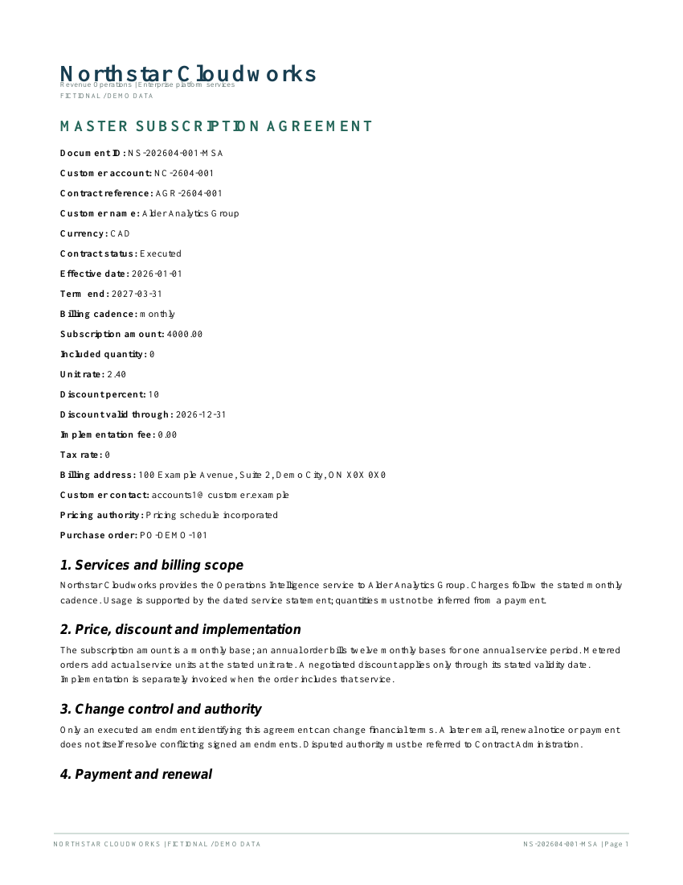
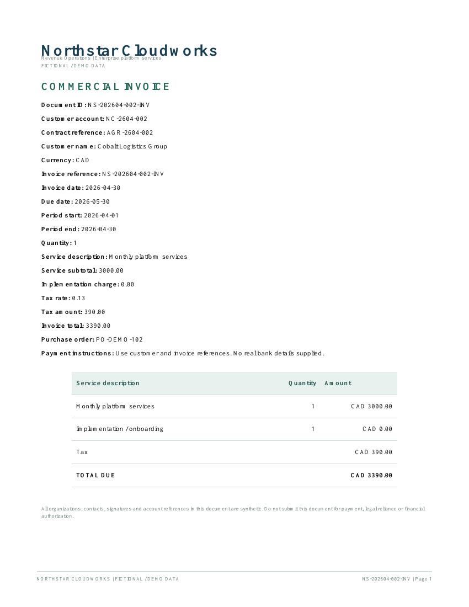
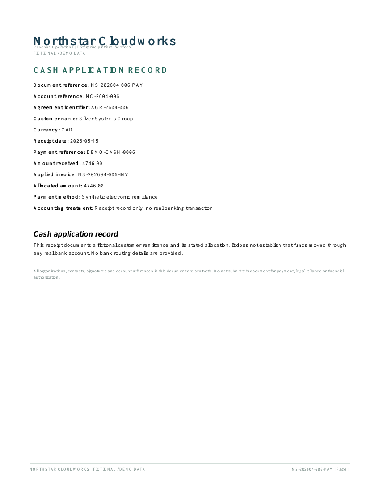

# Ledgerline 2.0 Stage 1 — document foundation

This standalone module adds real PDF intake and unified Revenue Operations work
items to the Phase 6.1 branch. It does not change the browser application, import
into a persona workspace, or touch existing customer fixtures, journals or analyses.
No OpenAI implementation or paid request is involved.

## Run the complete demonstration

Install optional dependencies into your existing environment:

```bash
# Windows Git Bash, from the repository root
.web-venv/Scripts/python.exe -m pip install -r requirements-documents.txt
.web-venv/Scripts/python.exe -m scripts.demo_documents --output work/northstar-demo-1
```

On Linux/macOS, replace `.web-venv/Scripts/python.exe` with `.web-venv/bin/python`.
Use a **new output directory** each time: existing directories are never replaced.
For a different batch add `--seed 892371`. No API key or running web server is needed.
A fresh virtual environment with these document dependencies alone is also supported.

The single demonstration command generates actual PDFs, reads their bytes through
pypdf, reconciles independently extracted facts, journals the work items, and then
invokes the separate evaluator. A nonzero exit status means evaluation failed;
the report is retained for inspection.

The default batch contains **149 PDFs, 40 fictional customers and 102 work items**:
73 eligible read-only checks, 29 exceptions, and 14 intentionally unresolved items.
That is a measured 71.6% of checks eligible for routine handling, not a promised
production automation rate. Eligibility does not mean the workflow was executed.
The report includes the intentionally invalid amendment date as a parse-validation
failure and an expected human-review item. It is not silently excluded.

Northstar Cloudworks provides fictional enterprise platform services. Its accounts
include monthly and annual subscriptions, metered usage, negotiated/expired discounts,
implementation, taxes, signed amendments, renewals, receipts, partial payments,
unapplied cash, proposed credits and contradictory invoice records. All organizations,
contacts, execution notations and account references are synthetic. No real signatures
or bank details appear in the documents.

## Files and source separation

```text
<output>/documents/*.pdf             Actual parser inputs only
<output>/evaluation/source_ledger.json  Generator source, never read by intake
<output>/evaluation/expected.json    Independent evaluation oracle
<output>/evaluation/report.json      All metrics and mismatches
<output>/evaluation/summary.json     Counts, distribution, runtime, provider usage
<output>/processing/results.json     Extracted text, fields, work items, evidence
<output>/processing/journal.sqlite3  Transactional intake/work/event history
```

The checked-in [example batch](../examples/ledgerline2/april-2026/) includes PDFs,
source ledger, expected outcomes and actual reports. Its database is intentionally
not versioned; run the command to create a new local journal. Generation is seeded;
PDFs are byte-reproducible. Processing timestamps record actual processing time.

Ingest an independent supported batch without generating fixtures or loading an oracle:

```bash
.web-venv/Scripts/python.exe -m scripts.ingest_documents \
  --input work/my-documents --database work/my-intake/journal.sqlite3 \
  --report work/my-intake/results.json
```

Input is a controlled local directory, not a public upload endpoint. Non-PDF files
are ignored. Symbolic links are rejected. The limits are 500 directory entries,
5 MiB per PDF, 20 pages and 200,000 extracted characters. Encrypted, malformed,
image-only and unrecognized layouts produce explicit review records. OCR is **not**
implemented. These bounds are not a sandbox for processing hostile internet files;
use a resource-isolated parsing worker before accepting untrusted public uploads.

## Supported interpretation and safeguards

The baseline identifies supported document headings and labeled business fields
from extracted page text. Two label/template variants are supported. It does not
infer contractual authority from a filename, a payment, a renewal notice, a scenario
number or an answer manifest. Unknown/missing/conflicting fields and invalid dates
remain visible. Missing fields are never supplied by defaults.

The baseline supports complete monthly periods and April–March annual service
periods in CAD, subscription base rates, actual metered quantities, dated discounts,
explicit implementation amounts and stated tax rates. Annual billing uses twelve
monthly bases. Currency, invoice arithmetic, period, quantity and authority checks
must pass before a financial comparison is published. Proration, other currencies,
other annual boundaries, and legal interpretation of arbitrary prose are outside
this baseline. A supported heading is not a claim that arbitrary prose was legally
understood; template terms require human approval before any production financial use.

The original billing engine is unchanged; its Decimal `money` validation and
rounding are reused. New scoped formulas do not broaden the existing April 2026
engine's rules. All arithmetic, date comparisons and eligibility are Python rules.
Conflicting or even a single unvalidated amendment is routed to Contract
Administration; the baseline does not decide amendment precedence. Proposed credits
always require financial authorization. Duplicate invoice references remain ambiguous:
their presence is not proof of duplicate charges. Payment advice is matched against
a receipt and never counted as additional cash.

Every field has page number, SHA-256, extracted span offsets/text and method. Work
items carry source IDs, extracted facts, evidence, financial impact when determinable,
original Billing Analyst/Contract Administrator ownership, the current Revenue
Operations Specialist role, status, eligibility reason, review requirement, timestamps
and event history. `synthetic` provenance is based on the visible source document
label; the processing itself is genuine deterministic extraction, not simulated AI.
No `AI Processed` or financial completion is claimed.

Content-addressed identities prevent repeated copies or re-ingestion from duplicating
work. Changed source bytes produce a new immutable evidence version while older
work remains in the journal. Results list the current batch, rather than summing
superseded work. SQLite writes are transactional and connections/cursors explicitly
close, including on failure, for Windows temporary-directory compatibility.

`close_routine(database, work_item_id, actor, rationale)` records an audited
administrative closure only for eligible read-only checks. It cannot close an
exception, issue a credit, change an invoice, allocate actual cash or resolve disputed
legal authority. Re-ingestion retains this history. The module has no billing-write,
external-communication or human-financial-approval endpoint.

`OptionalExtractionAdvisor.propose` is an extension interface for unverified proposals.
An explicitly supplied implementation writes segregated proposal records and cannot
change parsed authority, calculations or eligibility. No live provider adapter is
included. When an advisor is supplied, provider usage is reported as unknown, never
as a fabricated zero; a future live adapter must implement existing paid consent,
pricing, rate limits and auditable cost accounting before use. Neither application
startup nor generation/tests invoke this interface automatically.

## Evaluation and tests

The generator's oracle is derived independently from its structured ledger. Neither
parser nor reconciler imports the generator, evaluator or ledger. The alternate-batch
test deletes the evaluation directory before intake and forbids JSON reads.

Metrics include classification, every expected key field, customer/contract matching,
relationships, work precision/recall, actions/source documents, financial outputs,
non-null financial calculations separately, routing/review, eligibility, evidence
span integrity, unsafe closures and duplicate items. Missing parses stay in the
expected denominators. Unsupported inputs appear as review work rather than invented
successes. Perfect accuracy on this synthetic supported-template batch is not an
estimate of accuracy on arbitrary enterprise documents.

```bash
.web-venv/Scripts/python.exe -m pip install -r requirements-documents-test.txt
.web-venv/Scripts/python.exe -W error::ResourceWarning -m unittest discover -s tests_documents -v
```

Regression tests cover a separate random seed, custom unseen June contract/invoice
pairs, underbilling, contradictory amendments, real PDF evidence spans, unsupported
and malformed/encrypted/blank PDFs, missing authority, tax/currency/period failures,
nonfinite values, repeat processing, copied PDFs, journal cleanup, proposal isolation,
financial-review closure prevention and evaluation failures. Existing agent, web,
launcher, frontend and six browser smoke suites remain part of Windows/Ubuntu CI.

## Representative rendered documents

The images below are rendered from the committed PDFs, not mock browser screens.
The contracts continue onto a second page with payment and fictional execution terms.






