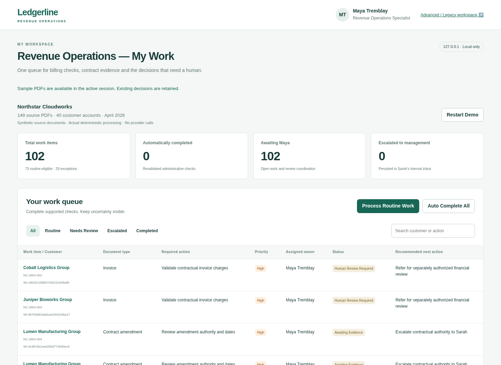
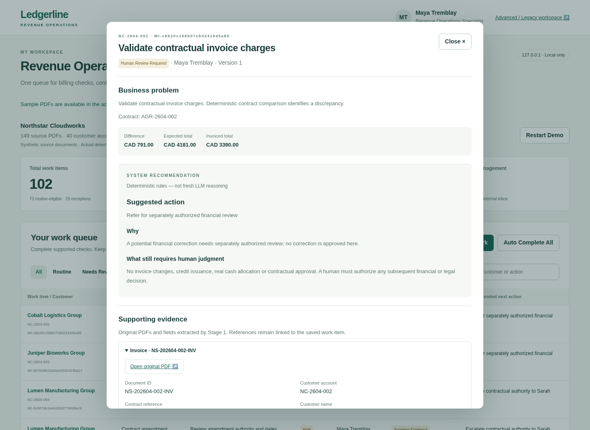
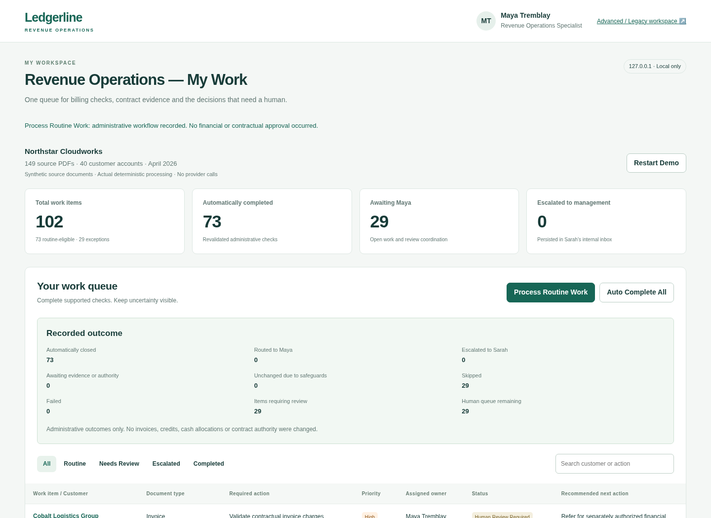
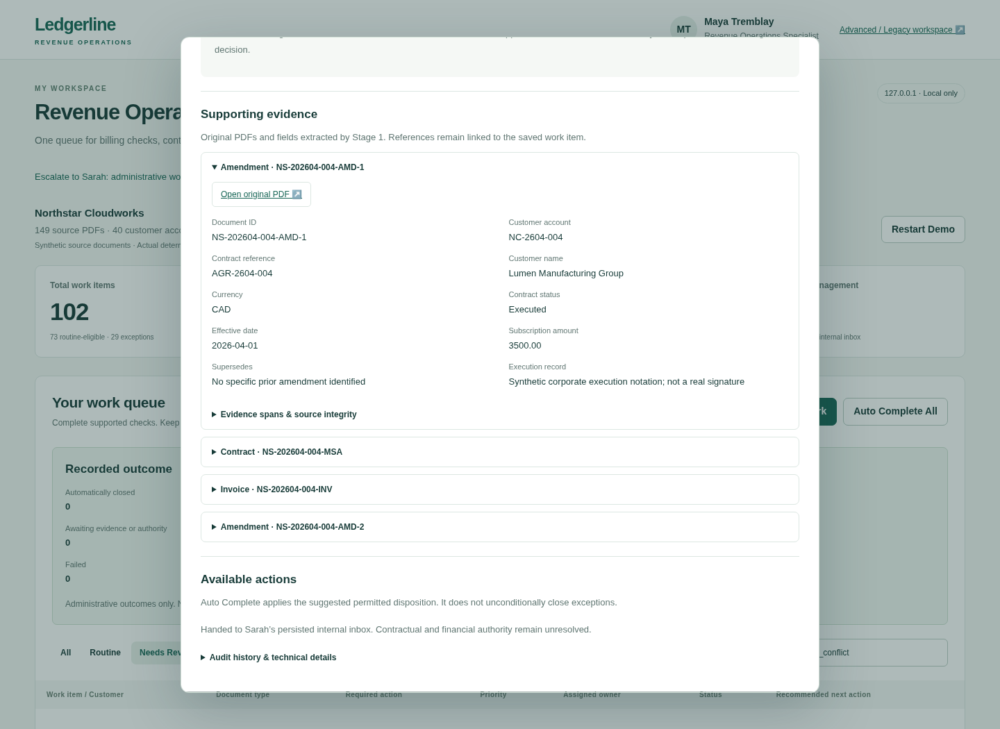
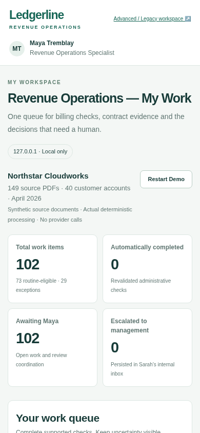

# Ledgerline 2.0 Stage 2 — Maya’s Revenue Operations workspace

Ledgerline now opens **Revenue Operations — My Work** at
`http://127.0.0.1:8000/`. Maya’s queue is backed by the actual Stage 1 PDFs and
persisted work items, not seeded completion counters. The Phase 6.1 application
remains available at **Advanced / Legacy workspace** (`/legacy`), including its
paid investigations, persona workflows and archive-only reset.

## Windows Git Bash: update, setup and launch

Stop the existing server with **Ctrl+C** before updating. Keep the same checkout,
runtime and run directories; do not delete or regenerate existing journals.

```bash
git fetch origin
git switch feature/ledgerline2-maya-workspace
git pull --ff-only
source .web-venv/Scripts/activate
python -m pip install -r requirements-web.txt
npm ci --prefix frontend
npm --prefix frontend run build
```

For a first installation only:

```bash
py -3.13 -m venv .web-venv
source .web-venv/Scripts/activate
python -m pip install -r requirements-web.txt
npm ci --prefix frontend
npm --prefix frontend run build
python -m scripts.build_agent_runtime ./agent-runtime-web
```

Python 3.13 and Node 22.12+ are required. The runtime builder requires a **new**
directory; skip that command if your existing isolated runtime is already installed.
PDF dependencies are now included in the web requirements. No API key, model pricing
confirmation or paid-run allowance is needed for this document workflow.

Double-click **Start Ledgerline.cmd**, use its existing desktop shortcut, or run:

```bash
python -m contract_to_cash.web
```

The application binds strictly to **127.0.0.1**. Stop it cleanly with Ctrl+C in the
launcher/server console. Linux/macOS use `.web-venv/bin/activate` instead of
`.web-venv/Scripts/activate`. See the [launcher guide](WINDOWS_LAUNCHER.md) for
installation checks and stale-server recovery. A running server uses its previously
loaded code: rebuild and restart after updates.

## Present the workflow

1. **Load Sample Documents**. Confirm the isolated import. The server copies the
   actual 149 Stage 1 PDFs into a new retained session and runs real extraction and
   reconciliation. The initial queue has 102 work items: 73 routine-eligible checks
   and 29 exceptions. **Automatically completed starts at zero.** Repeated import
   reuses the active session and does not duplicate work or reset decisions.
2. Open a row. Inspect the business issue, financial impact when determinable,
   recommendation and source fields. **Open original PDF** opens the actual saved
   bytes in a new browser tab. Source hashes and page/text spans are expandable.
   Unknown exposure is not shown as zero.
3. **Process Routine Work**. Confirm read-only administrative processing. The server
   re-extracts the current session PDFs and reruns Stage 1 rules. On the untouched
   sample, 73 checks complete and 29 exceptions remain. The summary reports actual
   completions, skipped work, required review, failures and remaining open work.
4. Filter **Needs Review**. A conflicting amendment needs authority, a proposed credit
   needs financial review, and unmatched or partial payments need reconciliation.
   The detail explains why automation stopped. Recommendations show **Suggested
   action**, **Why**, **Supporting documents** and **What still requires human
   judgment**. These are labeled deterministic rules, never fresh LLM reasoning.
5. Use **Auto Complete** on one item, or explicitly request evidence, accept/reject a
   suggested disposition, escalate to Sarah, or refer for separately authorized
   financial review. Enter attribution, rationale and reviewed source documents.
   Version checks reject stale decisions. An accepted recommendation is a workflow
   disposition, not acceptance of disputed contract terms or financial authorization.
6. **Auto Complete All** revalidates the remaining queue and applies only permitted
   dispositions. It can close supported read-only checks, route human review, defer
   missing evidence, escalate contractual authority, or refer financial review.
   It does **not** resolve every exception. Already escalated or financially referred
   work remains locked for the next authorized workflow; bulk processing cannot pull
   it back or close it. Rejected recommendations block automated processing until a
   new explicit, evidence-bound acceptance.
7. **Restart Demo** creates and selects a fresh unprocessed session after confirmation.
   The previous PDFs, decisions, escalations, events and results remain retained.
   Refresh uses the server’s durable active-session pointer, not an old browser ID.
   **Retained sessions & audit recovery** opens prior sessions read-only; **Return to
   active session** returns to current work. Nothing from legacy investigations,
   credentials, pricing or paid-launch history is reset.

All four headline metrics derive from stored states and events. “Awaiting Maya”
counts open work she coordinates, including items waiting for separately authorized
financial review; assigned owners remain explicit. “Automatically completed” counts
actual deterministic administrative-completion events, not initial eligibility.

## Recommendations and authority

Stage 2 provides a functional evidence-grounded deterministic recommendation baseline.
No live OpenAI advisor is implemented or invoked. The optional typed
`RecommendationAdvisor` / `RecommendationProposal` interface in
`web/document_recommendations.py` is a future integration boundary. Proposal validation
rejects unsupported dispositions, extra financial/authority fields and evidence outside
the work item. A proposal cannot close work or override authoritative facts.

A future live adapter must first use the existing explicit paid authorization, current
pricing, admission limits and usage/cost journaling. The free UI does not construct or
invoke an adapter. OpenAI usage and costs shown here are scoped to this document
session; legacy paid investigations retain their separate accounting.

A routine completion means a read-only reconciliation check is complete. No endpoint
in this namespace changes an invoice, issues a credit, moves/allocates actual cash,
resolves disputed legal authority, approves an export or sends external messages.
Even an individually confirmed financial-review referral leaves the financial decision
unapproved. Financial and legal authorizations remain outside this Stage 2 workspace.
Sarah’s full management UI and executive ROI reporting are not implemented in this PR.

## Persistence, recovery and concurrency

The new data lives beside the existing run root, **outside legacy reset scope**:

```text
runs/web/                              Existing Phase 6.1 history — unchanged
runs/web-documents/catalog.sqlite3      Active pointer, retained sessions, load operation IDs
runs/web-documents/<session-id>/
  documents/*.pdf                      Preserved original PDF copies
  journal.sqlite3                      Stage 1 documents/work plus workflow tables
```

If launched with a different `--runs` directory, the document root is its sibling
`<run-directory-name>-documents`. Never delete these directories to restart a demo.
Use **Restart Demo**. API callers must target the current active session; archived
session mutations are rejected.

SQLite connections/cursors and PDF streams explicitly close. Session publication
renames the fully written staging directory only after handles close, including on
Windows. The active pointer changes last in one catalog transaction. An interrupted
import leaves the prior active pointer intact and retains its `.building` directory
for inspection. A fully published orphan is recovered as retained, not silently selected.

Processing persists the operation ID and fingerprint first. Workflow state, per-item
events and the completed result commit atomically. On interruption no partial closures
survive; startup marks retained running operations interrupted without claiming success.
Retry the same operation ID with the same input to resume safely. Completed retries
return the saved result, without duplicate closures/events. A different input with an
already used ID is rejected. The browser preserves the ID when retrying an uncertain
request; if the result is unknown, refresh before assuming it failed.

One document command runs at a time. Imports, restarts and processing conflict with
active document operations or investigation workers. Existing server ownership and
shutdown protection remain in effect. A source PDF that is changed or removed cannot
be served as verified original evidence; processing routes affected items to review
and clears unsupported current financial determinations. Saved original extracted
facts stay in audit history. Restoring the exact original evidence permits fresh
revalidation, subject to current human-review safeguards.

`workflow_events` is append-only, enforced by SQLite update/delete triggers. Events
include item creation, source association, recommendations, human commands/decisions,
acceptance/rejection, processing start/completion, dispositions, evidence requests,
escalations, administrative closure, failures and retries. They preserve source hashes,
item versions, actor attribution, before/after states and timestamps.

Synthetic source provenance is separate from processing provenance. Real PDF/rule
processing is deterministic automation. Presenter-entered decisions are self-reported
human interactions, not fixture approvals. The browser acceptance harness explicitly
labels its scripted interactions `simulated_fixture`; those records are ephemeral and
are not shipped as genuine human history.

## Telemetry and management API

Expandable telemetry includes administrative throughput, routine completion rate
against initially eligible checks, human exception and escalation rates, status
transitions, wall-clock processing duration, human command count, errors/retries and
session provider usage/cost. Human labor and savings remain **Not measured**. Neither
fixture dates nor wall-clock runtime are converted to labor savings or ROI.

Protected, localhost-only APIs include:

- `GET /api/document-workspace` — current durable active session and metrics.
- `POST /api/document-workspace/load` and `/restart` — confirmed import/new session.
- `GET /api/document-workspace/sessions/{id}` — current or retained snapshot.
- `GET .../items/{work_id}` and `.../evidence/{sha256}` — details and actual PDFs.
- `POST .../process/routine` or `/process/auto_all` — idempotent batch commands.
- `POST .../items/{work_id}/{action}` — version-checked, evidence-bound disposition.
- `GET .../events` — ordered immutable workflow events.
- `GET .../management-inbox` — persisted Sarah escalations with original documents,
  recommendations, Maya’s decisions, prior statuses and full event history.

Write requests require the existing session, CSRF/Origin checks, operation ID,
attribution, rationale and `ADMINISTRATIVE WORKFLOW ONLY` confirmation. Individual
review decisions also require the current version and associated evidence hashes.
Recorded mode remains read-only. Persona selection and entered names are not RBAC or
verified identity. Passwordless local mode is **not suitable for public deployment**;
any network/public version must implement proper authentication and authorization
before enabling access. API credentials never reach the frontend.

## Validation and browser evidence

```bash
python -m pip install -r requirements-documents-test.txt
python -W error::ResourceWarning -m unittest discover -s tests_workspace -v
python -m scripts.export_web_schema --check
npm --prefix frontend run build
npm --prefix frontend test
python -m playwright install chromium --only-shell
python -m scripts.smoke_document_workspace
```

Windows/Ubuntu CI also runs every existing agent, web, launcher and document test,
the alternate-seed Stage 1 evaluation, and all six legacy browser workflows against
`/legacy`. The new browser workflow uses actual PDFs, checks source bytes and the
management inbox, confirms 73 actual closures, verifies unresolved cases and retained
restart/refresh, and checks mobile layout. No provider requests occur in validation.

The screenshots below are **browser-test evidence**, not a genuine employee’s approval
or live AI execution. The source PDFs and processing are real; scripted interactions
are explicitly simulated in the ephemeral acceptance session.











## Troubleshooting

- **Missing pypdf/reportlab**: reinstall `requirements-web.txt` in `.web-venv`, then
  restart the server. The launcher now checks these dependencies.
- **Old dashboard**: rebuild `frontend/dist`, restart Python and open `/`. The legacy
  application is at `/legacy`; its archive reset stays in that legacy application.
- **Sample batch unavailable**: restore the committed `examples/ledgerline2/april-2026/documents`
  folder from the same branch. Do not substitute the expected-results JSON or modify
  genuine run history. The application does not read the oracle.
- **Busy / HTTP 409**: wait for the active worker/command; retry from refreshed state.
  No second command is launched behind the presenter’s back.
- **Stale version / changed active session**: refresh before recording another decision.
- **Missing or changed source PDF**: retain the journal, inspect the warning and obtain
  valid evidence. A saved discrepancy is not current authority when its source changed.
- **Interrupted server / unknown result**: use the retained active snapshot and audit
  trail before retrying. Follow existing stale-server recovery instructions; never
  delete journals or paid-launch history to clear a lock.
