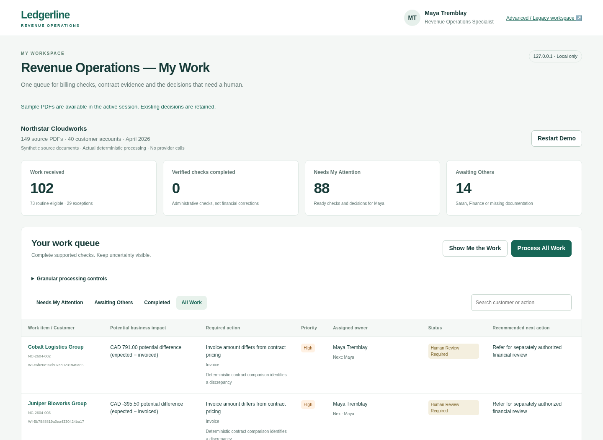
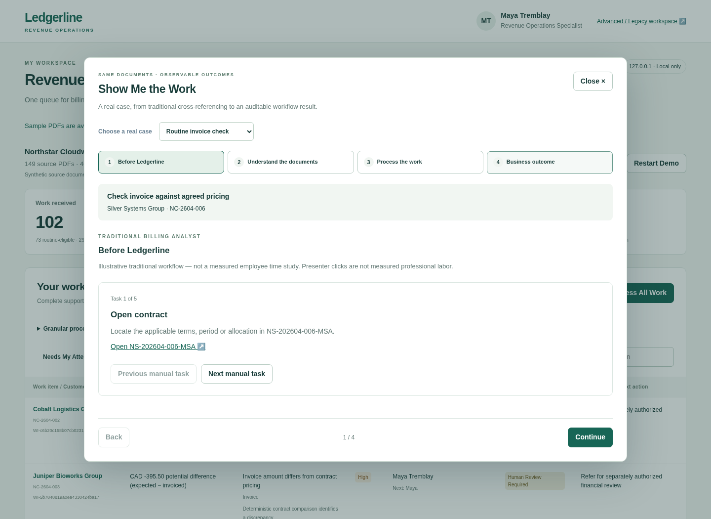
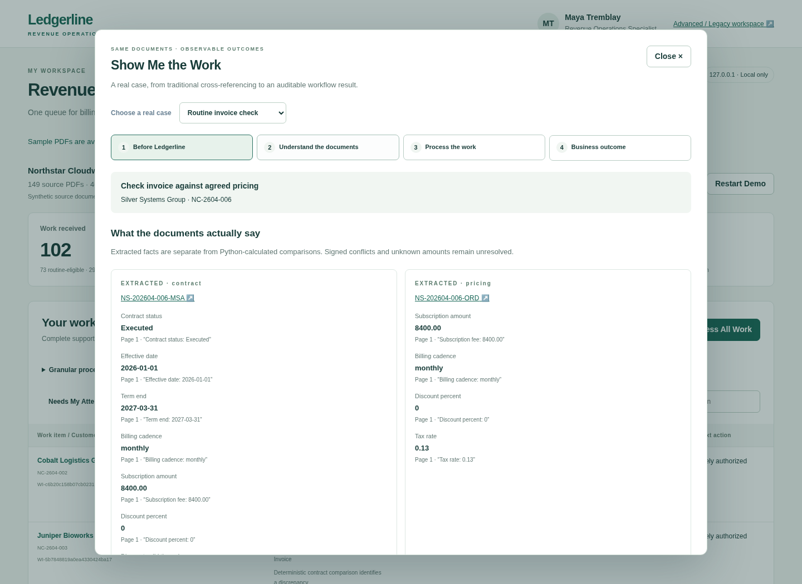
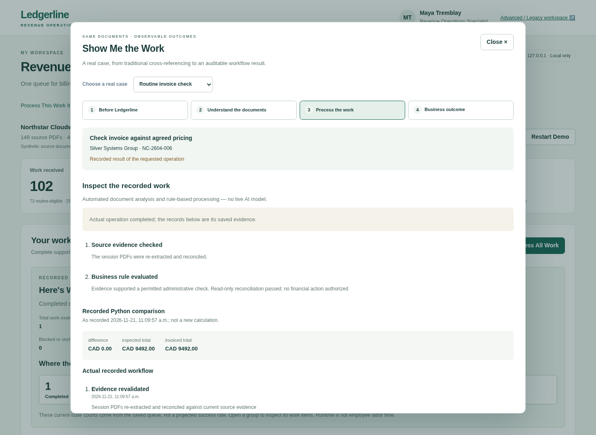
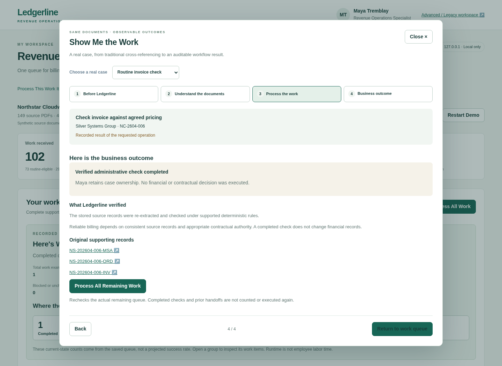
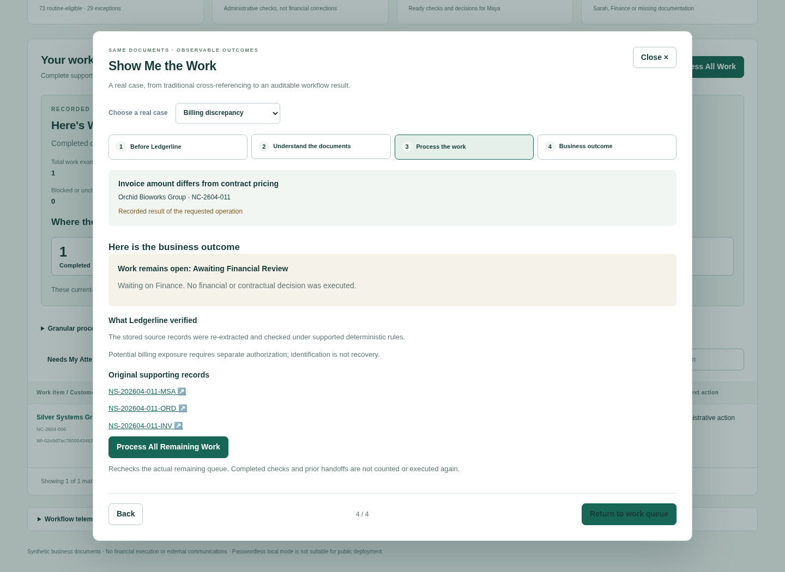
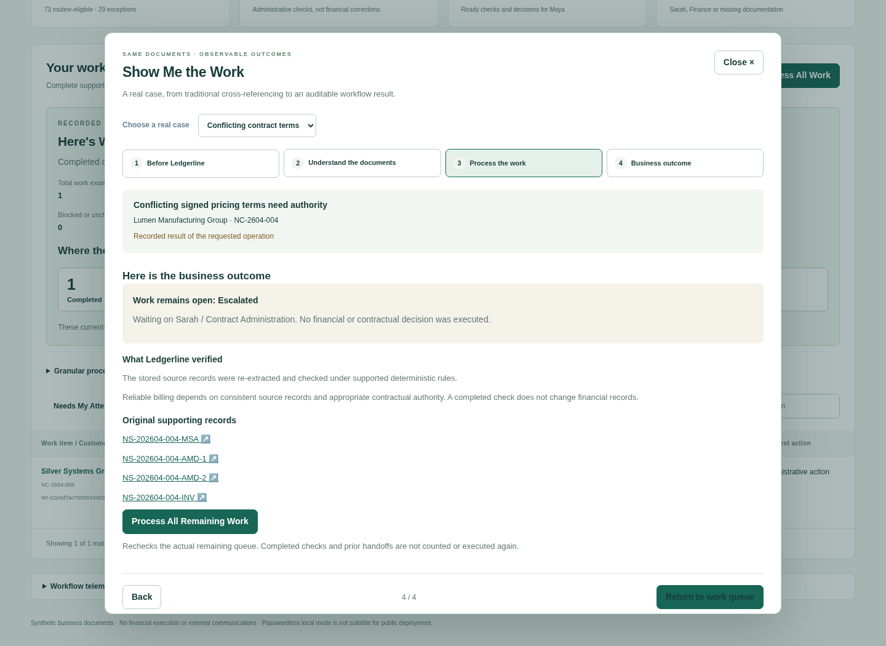
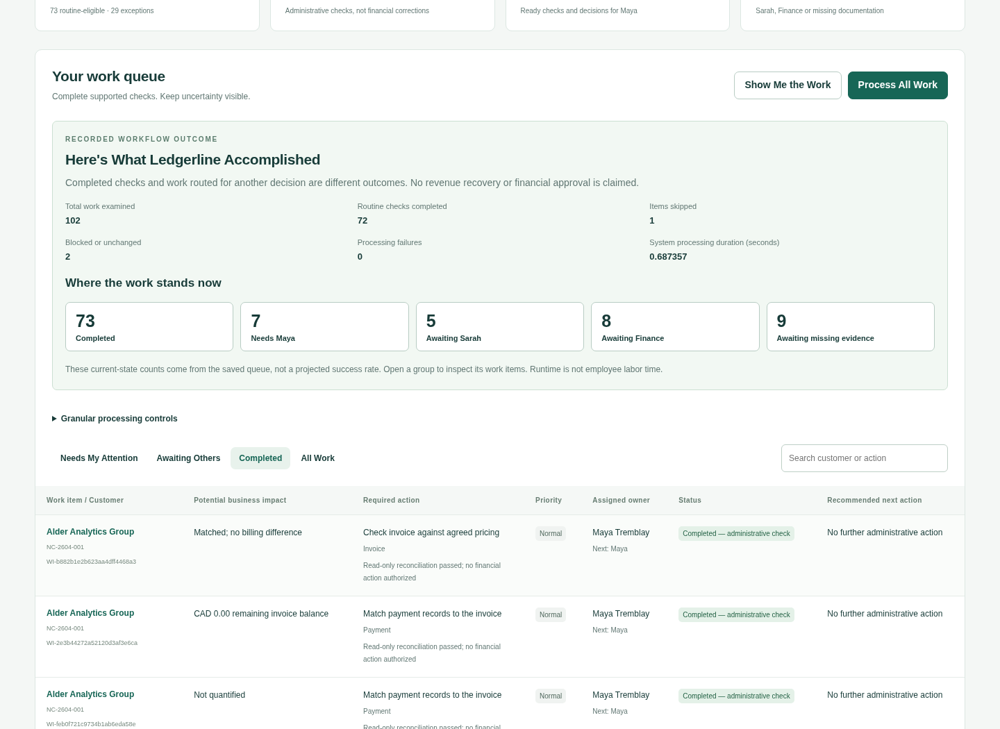
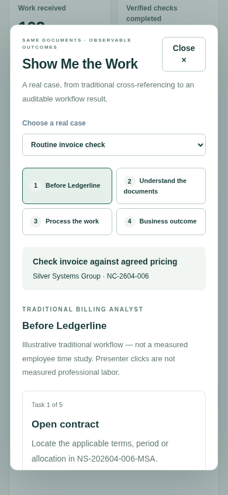

# Stage 2.5 — Show Me the Work

The default local dashboard now separates **Needs My Attention**, **Awaiting Others**
and **Completed**, with **All Work** available. Work titles, potential impact, case
ownership and next decision come from the persisted document-derived queue. The
single primary automation action is **Process All Work**. The existing granular
commands remain under **Granular processing controls**, with the same backend guards.

## Update and launch — Windows Git Bash

Stop the existing server with Ctrl+C before updating. Preserve all runtime/history
folders and credentials.

```bash
git fetch origin
git switch feature/ledgerline2-show-the-work
git pull --ff-only
source .web-venv/Scripts/activate
python -m pip install -r requirements-web.txt
npm ci --prefix frontend
npm --prefix frontend run build
python -m contract_to_cash.web
```

Alternatively double-click **Start Ledgerline.cmd** after rebuilding. Open
`http://127.0.0.1:8000/`. A previously running Python process must be restarted to
load new code. No API key or pricing confirmation is required for this free workflow.
For first-time Python 3.13 / Node 22.12+ setup and isolated runtime installation, use
[the Stage 2 guide](LEDGERLINE2_STAGE2.md). Linux/macOS activate
`.web-venv/bin/activate` instead. The server remains strictly bound to 127.0.0.1;
passwordless local mode is not suitable for network/public deployment. Proper
authentication and authorization remain mandatory before any such deployment.

## A presentation that shows the actual work

1. **Load Sample Documents**. The application reads the actual Stage 1 PDFs into an
   isolated session. On the unchanged sample there are 149 documents, 102 work items,
   73 routine-eligible checks and 29 exceptions. Completion starts at zero.
2. **Show Me the Work** opens the guided walkthrough. Choose **Routine invoice
   check**, **Billing discrepancy** or **Conflicting contract terms**. Cases come
   from available saved work, not fixture IDs. Missing scenarios are marked unavailable.
   The selected case stays pinned while its state updates; it never silently advances
   to another item after processing.
3. **Before Ledgerline** reconstructs the traditional Billing Analyst or Contract
   Administrator tasks for this specific item. Click the manual tasks and open the
   real contract, pricing schedule, amendment or invoice. This is an illustrative
   reconstruction, not historical employee activity or a time study. Presenter clicks
   are not labor measurements and create no historical human-work events.
4. **Understand the documents** shows extracted fields alongside original PDF links
   and actual page/excerpt references. Subscription base, dates, discounts, quantities,
   fees and tax remain separate from the saved deterministic financial comparison.
   Expected-versus-invoiced differences are potential exposure, not recovery. A signed
   conflict does not acquire an invented governing amount; unknown remains unknown.
5. **Process the work** offers **Process This Work Item** only when the item has no
   recorded disposition and current permissions allow processing. Confirm attribution,
   rationale, evidence and administrative-only scope. This calls the existing real,
   version-checked operation; it re-extracts/reconciles the session PDFs and records
   its actual evidence validation, rule result and workflow disposition.
6. Inspect the recorded operations. No fake progress stages, timers, model calls or
   artificial delays are used. The interface labels the engine **automated document
   analysis and rule-based processing — no live AI model**. A financial discrepancy
   stays open for Finance; conflicting terms stay open for Sarah/Contract Administration.
   Neither referral approves a correction or establishes contractual authority.
7. **Business outcome** distinguishes verified administrative completion from work
   merely routed for another decision. Original PDFs and actual event history remain
   accessible. **Process All Remaining Work** uses the current queue, not an assumed
   count of 101. Already completed checks and existing handoffs are skipped safely.
8. **Here’s What Ledgerline Accomplished** shows this operation’s examined count,
   completed checks, skipped/blocked items, failures and measured system duration.
   The current-state breakdown separately shows completed work, Maya, Sarah, Finance
   and missing evidence. Click a group to inspect its actual items. Financial or legal
   execution is never claimed. An unconfirmed or failed operation displays an error,
   not fabricated success statistics.

Suggested **20-minute presenter agenda**: introduction/load (2 minutes), traditional
work and source navigation (5), extraction/comparison (4), individual processing and
boundaries (4), remaining queue/results (3), Sarah handoff discussion (2). These are
presenter allocations, not measured employee labor or claimed savings.

## Everyday work, replay and restart

Rows use business titles such as **Invoice amount differs from contract pricing**.
The detail view answers **What’s happening?**, **Why does it matter?**, **What did
Ledgerline find?** and **What happens next?**. One recommended action is prominent;
secondary dispositions remain under **Other review actions**. Case owner Maya is
separate from the person/department waiting on the next decision. Source hashes,
text spans and full recorded event JSON are expandable, not removed.

Open **Show Me the Work** from an individual item to replay that specific case.
A previously processed case is explicitly labeled **Recorded replay — historical
processing; no new mutation**. Its recorded operation and validation proof are read
from existing events. Reopening, selecting manual steps or navigating the replay
never executes another mutation. New processing appears only after an explicit
confirmed operation. Earlier Stage 2 records without detailed validation proof are
honestly labeled as such; no missing processing steps are fabricated.

**Restart Demo** still creates a fresh active session with unprocessed work and
retains the previous session, source PDFs, decisions and audit. Refresh uses the
server’s active pointer. Retained sessions can be reopened read-only, including their
recorded walkthroughs. A session change closes an open walkthrough to avoid mixing
sessions. The original application remains at `/legacy`; its investigations, pricing,
credentials, paid-launch controls, journals and archive-only reset are unchanged.

## Implementation and audit contract

`web/work_presentation.py` contains read-only business grouping, scenario selection
and manual/source projections. It does not read a ledger/oracle, run a model or
change eligibility. `GET /api/document-workspace/sessions/{id}/walkthrough/{work_id}`
uses the existing reader/session/Origin/localhost boundary and verifies stored PDF
integrity through the existing detail/evidence interfaces.

Each actual processing operation now records `evidence_validation_recorded`, with
source hashes, actual parser/reconciliation identification, current-evidence outcome,
financial comparison when supported, eligibility and rationale. These are the real
outputs of that operation, committed with its workflow result. The walkthrough’s
explanations are projections of that proof and the actual recorded disposition events,
not six invented model/tool executions. Recorded comparison values carry their event
time and are not recomputed merely for replay.

Successful operation results additionally persist `total_examined` and
`queue_outcome`. Completed, Maya, Sarah, Finance and missing-evidence buckets partition
the queue; “Awaiting Others” combines the three waiting buckets. Examined includes
already completed/read records that are skipped; it is not a claim that every record
was automatically closed. The result panel’s breakdown is explicitly the current
saved queue, separate from the operation’s newly completed count.

All existing evidence revalidation, rejected-recommendation blocks, finance referral
scope, version checks, idempotency, immutable audit, interruption recovery, restart
retention and active-worker exclusion remain in the Stage 2 service. No paid advisor
is added. There are no invoice writes, credit issuance, real payment allocation,
external messages, export approvals or automatic contractual determinations. Runtime
is system wall-clock time; human labor, savings and recovery remain unmeasured.

## Tests and browser evidence

```bash
python -m pip install -r requirements-documents-test.txt
python -W error::ResourceWarning -m unittest discover -s contract_to_cash/tests -v
python -W error::ResourceWarning -m unittest discover -s tests_web -v
python -W error::ResourceWarning -m unittest discover -s tests_launcher -v
python -W error::ResourceWarning -m unittest discover -s tests_documents -v
python -W error::ResourceWarning -m unittest discover -s tests_workspace -v
python -m scripts.export_web_schema --check
npm --prefix frontend run build
npm --prefix frontend test
python -m playwright install chromium --only-shell
python -m scripts.smoke_document_workspace
python -m scripts.smoke_show_work --screenshots work/show-work-screenshots
```

Windows/Ubuntu CI also runs all six legacy browser workflows and the Stage 1
alternate-seed end-to-end evaluation. New tests check actual scenario selection,
missing scenarios, PDF bytes, extracted fields/spans, deterministic amounts, real
processing, Finance/Sarah stops, altered evidence, no fake proof for older events,
read-only authenticated replay, remaining-work counters and no duplicate handoffs or
completion. Browser checks cover all four steps and three scenarios, explicit human
confirmation, replay without POSTs, bulk drill-down, retained restart/refresh and
keyboard/mobile accessibility. No paid provider requests are made.

The following are acceptance-test screenshots. Sources and deterministic processing
are real; scripted browser interactions are explicitly labeled simulated fixture
activity in their ephemeral test session, not genuine employee approvals or live AI.


















