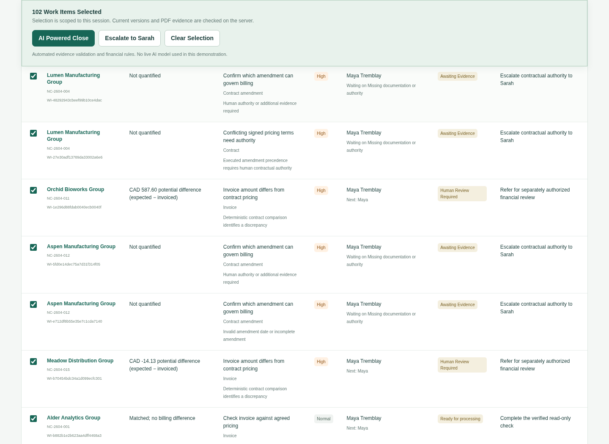
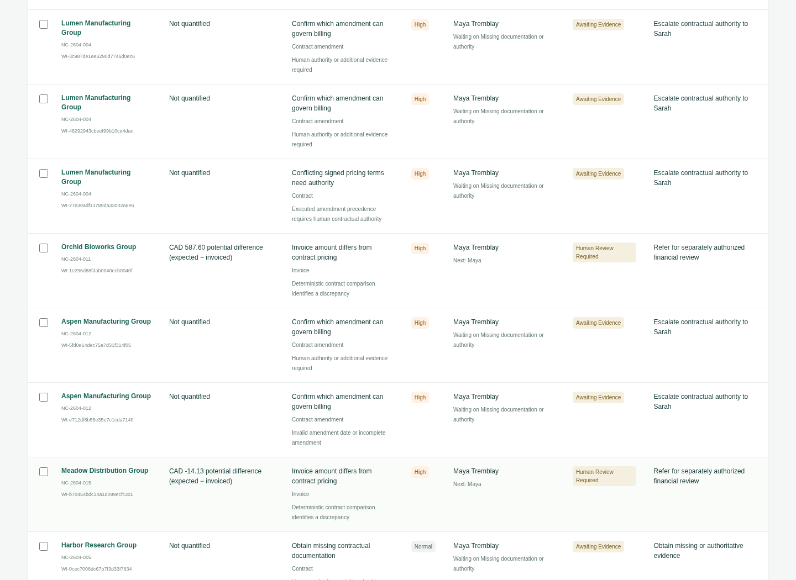
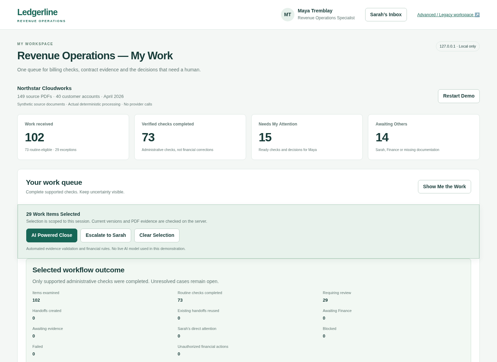
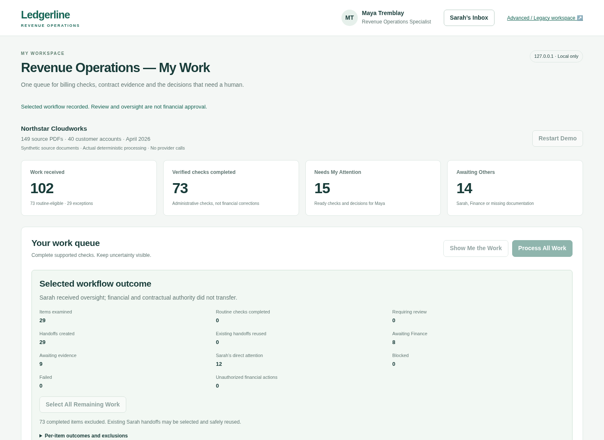
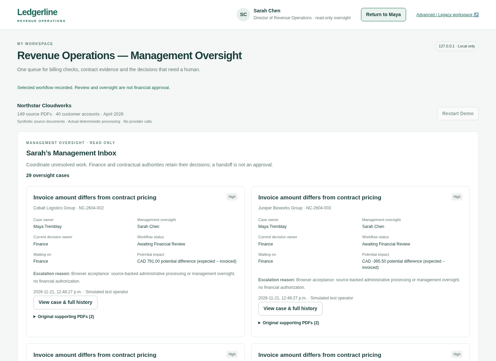
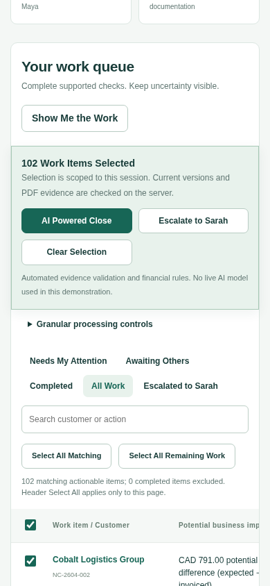

# Stage 2.6 — selected work and Sarah’s management oversight

Maya can select real document-derived work, complete eligible checks with **AI Powered
Close**, and hand remaining cases to Sarah in one confirmation. Despite the requested
product label, the implementation is **automated evidence validation and financial
rules; no live AI model is used**. No paid advisor is introduced.

## Windows Git Bash update and launch

Stop the existing server with **Ctrl+C**. Keep the checkout, isolated runtime and
history directories; do not delete SQLite files, PDFs, pricing or credentials.

```bash
git fetch origin
git switch feature/ledgerline2-bulk-workflow
git pull --ff-only
source .web-venv/Scripts/activate
python -m pip install -r requirements-web.txt
npm ci --prefix frontend
npm --prefix frontend run build
python -m contract_to_cash.web
```

Or double-click **Start Ledgerline.cmd** after rebuilding. Open
`http://127.0.0.1:8000/`. Python 3.13 and Node 22.12+ are required. For a first-time
installation use [Stage 2 setup](LEDGERLINE2_STAGE2.md); do not rebuild an existing
isolated runtime into the same directory. Linux/macOS activate `.web-venv/bin/activate`.

The server remains strictly on 127.0.0.1. Passwordless local mode is unsuitable for
network/public deployment, which requires proper authentication and authorization.
Persona switches and entered reviewer names are not verified identity or RBAC.

## Present the complete workflow

1. **Load Sample Documents** imports the actual 149 Stage 1 PDFs. The untouched
   sample produces 102 work items and zero completed work. No answer manifest or
   precomputed results are loaded by processing.
2. Check **Select All** in the table header. It selects the actionable items on the
   **current page**, not hidden pages. The checkbox becomes mixed when only part of
   that page is selected. Individual row checkboxes can be added or removed.
3. **Select All Matching** selects every actionable item behind the current filter
   and search, across pages. The active-session queue initially permits selecting all
   102. The sticky toolbar displays the exact count. **Next Page / Previous Page**
   preserve selections. Completed rows are disabled with an explanation.
4. Click **AI Powered Close**. The adjacent text explains that this is deterministic
   evidence/rule processing, not live AI inference. Enter attribution and a shared
   rationale, then confirm administrative-only scope. Optional per-item notes are
   available in the confirmation’s expandable section.
5. The server fetches actual current rows, checks captured versions, re-extracts PDFs,
   reconciles the facts and closes only supported read-only checks. On the unchanged
   sample, 73 checks complete and 29 remain for review. No invoice, credit, cash or
   contractual action is authorized or executed.
6. Use **Select All Remaining Work** in the saved result panel. It selects outstanding
   work across the entire active session, regardless of the current page/filter. It
   reports completed exclusions; it does not assume the number remaining is 29.
7. Click **Escalate to Sarah**. One shared attribution/rationale confirmation covers
   the selected batch. The resulting summary reports created/reused handoffs, actual
   Finance/evidence/Sarah decision queues and any blocked/failed cases.
8. Switch to **Sarah’s Inbox** in the header. This read-only presentation view shows
   persisted oversight cases, original PDFs, extracted findings, potential impact,
   recommendations, rationale and full case history. Open **View case & full history**
   to inspect the existing source-backed detail. Return to Maya to continue work.

While there is a selection, its contextual toolbar replaces the general top-level
Process All Work action. Clear Selection returns to ordinary queue controls. Stage
2.5’s **Show Me the Work**, **Process All Work**, granular controls and read-only
recorded replay remain available; the selected walkthrough stays pinned to its case.

## Oversight is not approval authority

Every new handoff preserves separate fields:

| Field | Meaning |
| --- | --- |
| Case owner | Maya retains case accountability |
| Management oversight owner | Sarah coordinates/prioritizes unresolved work |
| Current decision owner | Finance, an evidence/contract authority, or Sarah’s management coordination |
| Workflow status | Actual pending state; not overwritten merely to make every case “Escalated” |
| Waiting-on department | The party needed for the next decision |

A case **Awaiting Financial Review** remains in that status with **Finance** as its
current decision owner while Sarah receives oversight. A supported potential correction
that was not yet referred is marked for Finance, not approved by Sarah. An **Awaiting
Evidence** case remains awaiting records/authority. Contract conflicts can be escalated
to Sarah/Contract Administration, without choosing the governing signed terms.

Each handoff has a stable ID, original source hashes/references, timestamp, requesting
attribution, shared rationale, optional item note and explicit
`financial_authority_transferred: false`. Reusing an existing handoff creates no second
escalation. Existing Stage 2/2.5 escalations remain visible and are treated as retained
handoffs, without fabricating new historical approvals.

**Escalated to Sarah** filters oversight membership rather than requiring every case
to have status Escalated. Maya’s **Needs My Attention** excludes handed-off cases;
**Awaiting Others** and the oversight filter retain them with their true status.
Sarah’s view is management context, not an authorization screen. No financial or
contract approval controls are added.

Individual **Escalate to Sarah** uses the same selected-operation backend rules,
requires attribution/rationale/current version/reviewed evidence, and can refer a
Finance case for oversight without transferring its financial decision. Once oversight
exists, detail shows the existing handoff instead of a duplicate action.

## Results, partial success and recovery

Each selected operation returns aggregate counts and a **per-item outcome**:
completed, requires review, handoff created, handoff reused, skipped, blocked or failed.
The summary is not blanket success when any item is blocked or failed. Expand
**Per-item outcomes and exclusions** to inspect the reason and the underlying case.
Finance/evidence/direct-Sarah totals are subgroups of successful oversight handoffs;
they are not additional work items to add to the examined total.

AI Powered Close does not route every exception or claim their resolution. Its
ineligible cases stay open with recorded validation/review evidence. Management
escalation coordinates that remaining work. Existing global automation cannot silently
take back a management handoff or bypass a rejected recommendation.

Completed selected results are persisted in the existing session journal and restored
by browser refresh. An interrupted selected operation is explicitly displayed as
interrupted, never as successful uncommitted work. The existing active pointer and
retained history remain authoritative after refresh/restart.

Selections carry their session ID and the item versions captured when selected. They
are cleared on **Restart Demo**, session changes and switching into Sarah’s read-only
view. Versions are not silently upgraded when refreshed. A stale case is blocked
individually while valid selected cases continue. A previous session’s selection
cannot mutate a new session even though document-derived work IDs can be the same.

## Backend contract

Protected endpoints:

- `POST /api/document-workspace/sessions/{id}/selected/close`
- `POST /api/document-workspace/sessions/{id}/selected/escalate`

Both use a single `SelectedCommand` with an operation ID, expected session, attribution,
rationale, administrative-only confirmation and `selected` entries containing
`id`, captured integer `version` and optional `note`. IDs must be unique and selection
size is bounded. The browser sends one command, not dozens of independent mutations.

The selected service uses Stage 2’s actual PDF revalidation/reconciliation engine and
a shared completion-eligibility predicate. AI suggestions cannot override those rules.
No paid advisor is constructed or called; the existing future advisory interface is
unchanged and remains subject to paid authorization/admission/accounting requirements.

The existing journal’s operation ID/fingerprint prevents duplicate actions. Different
input with an already-used ID is rejected. Replaying a completed request returns its
saved result. To retry only failed rows after partial success, submit a **new** operation
ID and their current versions; replaying the original ID intentionally returns its
original result rather than repeating already committed successes.

One operation holds the existing workspace/worker exclusion guard. Per-item savepoints
isolate handled failures; all successful outcomes and their events commit with the
completed result. A process interruption rolls back the uncommitted batch, retaining
an interrupted attempt for recovery; it cannot claim partial committed success. Startup
retains/reclassifies running attempts honestly, and the same operation ID can be retried.
SQLite connections/cursors close explicitly on success and failure, including Windows.

`GET .../management-inbox` now includes both explicit oversight records and retained
legacy escalations, with the same original documents, extracted findings, exposure,
recommendations, statuses and immutable history. No separate copy of business facts
is created for Sarah. Header and per-item actor attribution retain the existing local
session/CSRF/Origin and loopback boundaries. `/legacy`, paid-launch limits, original
investigations and all retained sessions/PDFs/journals remain intact.

## Validation and screenshots

```bash
python -m pip install -r requirements-documents-test.txt
python -W error::ResourceWarning -m unittest discover -s tests_workspace -v
python -m scripts.export_web_schema --check
npm --prefix frontend run build
npm --prefix frontend test
python -m playwright install chromium --only-shell
python -m scripts.smoke_bulk_workflow --screenshots work/bulk-workflow-screenshots
```

Windows/Ubuntu CI runs all existing agent, web, launcher, document and workspace suites,
the alternate-seed Stage 1 evaluation and all nine browser workflows. New tests cover
selected-only execution, all/individual/page/matching selection, sticky positioning,
73 real closures and unresolved exceptions, independent Finance/evidence ownership,
new/reused handoffs, partial item failures, stale/foreign IDs, changed PDFs, interrupted
transactions, idempotent retries, archived-session isolation, existing replay, restart
and restored results. Existing Stage 1, 2 and 2.5 tests are retained.

Acceptance screenshots below show actual PDF processing in an ephemeral test session.
Scripted interactions are labeled simulated fixture activity, not genuine employee
approvals. No paid OpenAI requests occur.












