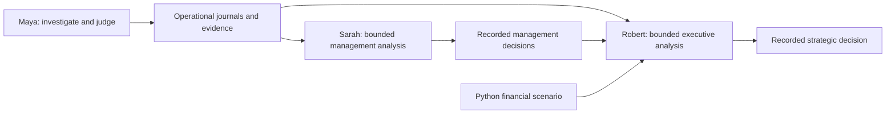

# Phase 4 · One AI implementation, three organizational levels

Ledgerline now connects **Maya Tremblay**, Revenue Operations Specialist; **Sarah
Chen**, Director of Revenue Operations; and **Robert Mitchell**, CFO, in one local
application and one persisted workflow. The header switcher changes presentation
context without logout, a new server, a new dataset or lost investigation history.
These are fictional demo personas, **not authenticated identities or production RBAC**.
Actual local reviewer attribution remains server-configured and is recorded separately.

Built from merged main `f880912` on `feature/phase4-enterprise-personas`. The PR targets
main and has no unmerged prerequisite. No paid OpenAI request, deployment or merge
occurred during implementation. All new browser artifacts are explicitly simulated.

## The connected experience

### Maya · Individual productivity

The existing four-scene experience remains: Start Billing Review → actual investigation
activity → saved findings → human judgment. Original source inspection, evidence-backed
resolution, escalation/dismissal, scoped continuation, rationale, revision checks and
separate export authorization remain functional. AI does the investigative work; Maya
provides judgment. Switching roles never approves or exports an operational finding.

### Sarah · Departmental efficiency

Sarah's overview shows persisted account comparisons/screening, evidence-verified
findings, outstanding review items, reviewed/dismissed items, actual human contributions,
recorded durations and completion status. Uninvestigated structured screening flags are
disclosed separately; they are neither verified findings nor asserted financial exposure.
These are **single-operator prototype measurements**, not department-wide performance,
employee productivity, staffing utilization or historical trends.

**Analyze Department Performance** opens a separate paid-confirmation step. The model
selects read-only snapshot tools to examine observed facts, saved human workflow,
shared discrepancies and cited source records. It persists observations (explicitly
AI interpretations), hypotheses, recommendations and limitations. Shared templates
and matching discrepancies are correlations; no configuration defect is declared proven.

Sarah can prioritize, create an internal follow-up, record an owner, request further
investigation or dismiss a recommendation. Rationale and supporting cited inputs are
required. Follow-up/assignment/investigation-request actions require an owner. These
are durable **internal records**; no email, ticket or external assignment is sent, and
an investigation request never silently starts another paid job.

### Robert · Financial strategy

Robert sees supported potential receivables and customer credits separately, known
open review differences, unquantified cases, investigation API cost estimates, and
completion context. Receivables are not collected revenue; credits are not savings.
Unknown conflict/duplicate exposure is never fabricated. USD execution estimates remain
separate from CAD financial exposures and assumptions; no FX rate is invented.

Robert can edit and save a Python-calculated scenario, inspect Sarah's recorded
priorities, then explicitly authorize **Evaluate AI Expansion Opportunity**. The model
must read observed metrics, saved management context and the saved financial scenario
before persisting an executive stance. Its output is a qualified recommendation,
not independently verified financial facts or an approval.

Robert records **Approve proposed expansion pilot**, **Request additional validation**
or **Defer expansion**, with rationale and cited support. This is a local demonstration
record, not an actual budget allocation, staffing change, purchase or financial mutation.

## Deterministic financial scenario

Defaults are illustrative assumptions supplied for this demo, never measured benefits:

| Per comparable team, annually | CAD |
| --- | ---: |
| Traditional Billing Analyst + Contract Administrator | 180,000 |
| Redesigned Revenue Operations Specialist | 90,000 |
| AI/software operating expenses | 5,000 |
| Redesigned recurring cost | 95,000 |
| Potential recurring annual net benefit | 85,000 |
| Recurring cost reduction | 47.22% (approximately 47.2%) |

All annual costs are **per team**. One-time implementation cost is a **total across
all teams**. For `n` teams, Python Decimal calculates:

- Previous recurring annual cost = traditional employment × n.
- Redesigned recurring cost = (redesigned employment + annual software) × n.
- Recurring annual benefit = previous cost − redesigned cost.
- First-year net benefit = recurring benefit − total implementation cost.
- Cost reduction = recurring benefit / previous cost × 100; undefined if previous
  cost is zero.
- Illustrative payback months = implementation / positive recurring benefit × 12,
  assuming uniform monthly realization. No payback is reported for non-positive benefit.

Amounts and percentages use explicit half-up rounding. Inputs reject negative costs,
non-finite values and invalid team counts. The optional workload-reduction percentage
is an **assumption only** and does not discount salaries a second time. No staffing
reduction is inferred from the prototype. Unsaved edits never alter displayed saved
outputs or the assumptions used by an analysis. Saved scenario versions persist and
invalidate older executive analyses before another consequential decision can be made.

## Aggregation and evidence scope

The selected operational review is the common origin for all three personas. A child
run resolves to its originating review. The active view uses that review and valid
completed scoped continuations; a continuation replaces its affected customer's case
instead of adding the original exposure again. Partial attempts remain in execution
history and contribute recorded costs/durations, but do not silently supersede cases.

Financial differences are deduplicated by customer, including overlapping individual
and grouped findings. Conflicting amounts are excluded, not summed arbitrarily. Only
current evidence-verified findings contribute supported monetary differences. Stale
source/authority revisions invalidate exposure and decisions. A human dismissal retains
the underlying deterministic comparison for audit; it cannot erase a validated billing
difference or change records. Workflow resolution and actual financial correction are
separate concepts. Counts describe saved review items; a grouped finding can cover
multiple customer accounts.

Screened/compared account IDs are distinct across the family; screening is not deep
source investigation. Empty history shows no invented discoveries. Incomplete reviews
and outstanding screening flags are disclosed. Potential totals describe supported saved
cases, not a complete estimate of an unfinished period-wide investigation.

Original documents, finding versions, source/derived revisions and recorded human
contributions are copied into immutable analysis input snapshots with exact reference
IDs. Recommendations cite only inputs actually retrieved by the analytic tools. Sarah's
saved analysis/decisions are inputs to Robert's executive workflow; stale management
analysis is explicitly marked in that context. Original operational findings and any
approved exports keep their existing, separately enforced authorization boundaries.

## Architecture and persistence

[The pre-implementation design note](PHASE4_DESIGN.md) records the inspected architecture.
There is one app, one worker and two scoped uses of the existing Responses runtime:



`Investigator` now accepts optional instructions and the supplied tool definitions,
plus an optional report-finalization hook. Its normal operational toolset, calculations,
budget checks, usage accounting, stateless Responses history and error handling remain.
The analytics toolset has exactly three capabilities:

| Tool | Permission |
| --- | --- |
| `get_analysis_overview` | Read actual aggregate metrics, limitations and reference catalog. |
| `get_analysis_reference` | Retrieve one exact allowlisted immutable input reference. |
| `save_analysis` | Persist cited interpretations, hypotheses, recommendations and limitations. |

It cannot access arbitrary files, sealed evaluation material, send messages, approve
findings, export evidence, allocate budgets or mutate financial records. Model prose
is never used as an authoritative financial value. Citation checks establish input
traceability, not the truth of every model interpretation; human review remains essential.

The new `runs/web/enterprise.sqlite3` is created lazily with additive tables:
`analyses`, `enterprise_decisions`, `enterprise_events`, `enterprise_settings`.
Scenario versions/events and immutable analysis snapshots/results/decisions are retained.
Each analysis also has an ordinary per-execution journal/report under
`runs/web/analyses/<id>`. Existing operational journals and reports need no migration
or rewrite. Restarted queued/running analyses become interrupted, never automatically
resumed or retried. Failed startup closes the store-lock handle before reporting failure.

### Shared paid safeguards

Every analysis requires explicit paid consent, a current source revision, a saved
finding, server-side API configuration and fresh administrator-confirmed official
pricing. It uses **gpt-6.1-sol**, default tier, existing conservative estimation and
**35 tools, 40 Responses requests, 180 seconds, US$1 estimated cost**. Estimates are not
actual provider invoices. Missing/incomplete usage remains unknown, not reported as zero
actual billed cost. Actual events, tool choices, report versions and usage are retained.

Investigations, continuations and both analytic roles share one worker, **one paid
launch/minute and three/hour**. Confirmations and paid limits are not reset by switching
personas or archiving history. Idempotent retries return the same retained execution;
reusing a key for another paid workflow or an archived request is rejected. Human
enterprise decisions bind a completed current analysis and its cited recommendation.
Source, workflow or scenario changes block stale decisions without deleting history.

## Windows startup and demo sequence

Use the existing [Windows launcher setup](WINDOWS_LAUNCHER.md). After updating an
installed checkout, stop the original console cleanly with **Ctrl+C**, then from Git Bash:

```bash
source .web-venv/Scripts/activate
python -m pip install -r requirements-web.txt
npm ci --prefix frontend
npm --prefix frontend run build
./Start\ Ledgerline.cmd
```

Or double-click **Start Ledgerline.cmd** after rebuilding. Python 3.13 and Node.js
22.12+ remain supported. Keep the same isolated runtime and runs folder; no history
reset or manual database migration is required to upgrade. Use the existing secure
server-side API binding and reviewer configuration. No key belongs in browser variables,
shortcut arguments or committed files. No operator password or persona login is added.

Suggested genuine presentation sequence:

1. In Maya's workspace, open a retained real review or explicitly authorize one new
   billing review. Inspect source evidence and record a real supported human action.
2. If genuine authority evidence supports resolution, use the existing Phase 3.2
   registration and separately confirmed continuation. Do not invent a governing document.
3. Switch to Sarah. Explain the saved review's scope and incomplete work, authorize
   one management analysis, inspect its cited inputs and record an internal priority/owner.
4. Switch to Robert. Show Sarah's saved decision, edit/save assumptions, explicitly
   authorize executive analysis and record a qualified strategic decision.
5. Show source/history traceability and explain that no bill, export, ticket, budget
   or workforce action was executed by those management/executive decisions.

Respect the real shared throttle: allow at least one minute between paid launch starts,
with no more than three launches in a rolling hour. A new operational review + a
continuation + two analyses would be **four** paid launches, so demonstrate retained
operational work or schedule that full sequence across the rolling limit. Do not
raise limits for a live presentation. No genuine model run or live benchmark was
performed in this phase. Do not import simulated test runs as genuine recordings.

## Reset Demo and archival recovery

In **Advanced Settings → Reset Demo → Review reset scope**, inspect the count and
scope, then type **ARCHIVE DEMO HISTORY**. Reset is archive-only; no permanent deletion
is implemented. It refuses while any investigation/analysis or its worker is active.

It moves active run folders/index, analysis journals and enterprise history/scenario
into `runs/web/archives/<id>` with an attributed manifest. Operational human decisions
move with their journals; management and executive decisions move with the enterprise
journal. The active workspace clears for all three personas and returns to Maya.
Other open clients detect the workspace epoch change and reload their empty view.

Preserved: synthetic source dataset, administrator pricing (still subject to expiry),
registered source-authority records, API credentials, launcher settings, previous
archives and the live store lock. Imported read-only recordings are not removed; reset
is unavailable in recorded mode. A dataset overlapping a planned archive path causes
reset refusal. No OpenAI request is made. Archived launch timestamps and request keys
remain enforced by paid throttling/idempotency.

Readers and reset share the store lock; SQLite connections/cursors and file reads
close before rename, including Windows. A move failure rolls back completed moves.
If rollback cannot finish, `.reset-recovery.json` remains and writes/paid launches are
blocked. Stop the server, back up the **entire** runs folder, inspect that marker and
`archives/<id>/manifest.json`, and reconcile each listed move before reopening. Do not
blindly delete the marker, overwrite history, ignore cleanup failures or remove an
owned server lock. The manifest lists the old/new epochs and planned names. There is
no automated disaster-recovery or archive-restoration UI; archives remain available as
local retained artifacts for inspection/recovery.

## Validation

Python 3.13: **78 agent tests, 75 web tests and 18 portable launcher tests pass** with
ResourceWarning treated as error. Two native Windows tests skip on Linux and remain
in Windows CI. **15 frontend tests**, TypeScript/production build and schema drift checks
pass. Existing Phase 3.1 and Phase 3.2 browser workflows pass alongside the new connected
enterprise workflow. Native Windows desktop execution remains for Windows CI/review.

Nineteen new backend tests cover aggregation, shared patterns/overlap deduplication,
scoped replacement, source/assumption revisions, cited model inputs, internal decisions,
exact scenario math and invalid inputs, consent/CSRF/shared limits, API failure/partial
results, restart interruption, archive preservation/rollback/recovery, archived/cross-
workflow replays, recorded separation, financial/export boundaries and startup cleanup.
Browser checks cover role switching without state loss, all three human contributions,
ROI edits, actual simulated-SDK tool activity, supporting inputs, reload, desktop/390px
mobile, explicit reset and an empty new workspace with pricing preserved.

Reproduce in a test environment with `requirements-web-test.txt` installed:

```bash
python -W error::ResourceWarning -m unittest discover -s contract_to_cash/tests -v
python -W error::ResourceWarning -m unittest discover -s tests_web -v
python -W error::ResourceWarning -m unittest discover -s tests_launcher -v
python -m scripts.export_web_schema --check
npm --prefix frontend test
npm --prefix frontend run build
python -m playwright install chromium --only-shell
python -m scripts.smoke_web
python -m scripts.smoke_continuation
python -m scripts.smoke_enterprise --screenshots ./work/phase4/screenshots
```

The enterprise browser test uses **simulated SDK responses** and an explicitly isolated
**test-only cooldown override** so a test can complete in seconds. Production has no
such flag or override; independent API tests exercise real limits. Actual Python tools,
financial calculations and SQLite persistence run normally. No paid calls occur.

## Labeled screenshot gallery

**Every image is an automated test: simulated SDK, actual local Python/SQLite,
test cooldown override, no paid API calls.** These are not genuine model executions,
financial discoveries or measured organizational savings. All carry an embedded label.

| Workspace / decision | Screenshot |
| --- | --- |
| Maya's operational workspace | [Start](screenshots/phase4/01-maya-operational-workspace.png) |
| Maya's saved human judgment | [Clarification](screenshots/phase4/02-maya-human-judgment.png) |
| Sarah's management overview | [Overview](screenshots/phase4/03-sarah-management-workspace.png) |
| Genuine local test journal activity | [Analysis activity](screenshots/phase4/04-sarah-real-test-activity.png) |
| Sarah's saved management decision | [Internal follow-up](screenshots/phase4/05-sarah-persisted-decision.png) |
| Robert's saved financial scenario | [Python ROI](screenshots/phase4/06-robert-saved-financial-scenario.png) |
| Robert's saved strategic decision | [Pilot decision](screenshots/phase4/07-robert-persisted-strategic-decision.png) |
| Robert on mobile | [Executive mobile](screenshots/phase4/08-robert-mobile.png) |
| Sarah on mobile | [Management mobile](screenshots/phase4/09-sarah-mobile.png) |
| Explicit administrator archive confirmation | [Reset](screenshots/phase4/10-confirmed-archive-reset.png) |
| Maya after archival | [Empty active workspace](screenshots/phase4/11-maya-after-archive.png) |

## Changed files and remaining boundaries

| Area | Files / purpose |
| --- | --- |
| Aggregation / ROI | `web/enterprise_metrics.py`: selected-root/continuation metrics, deduplicated exposures, scenario validation and Decimal math. |
| Analytic execution | `web/analysis_tools.py`, small optional hooks in `agent/runtime.py`: model-selected snapshot tools, cited outputs and shared bounded Responses orchestration. |
| Persistence / decisions | `web/enterprise.py`: SQLite snapshots, scenarios, analysis lifecycle, internal human records and current-source checks. |
| Reset / lifecycle | `web/demo_reset.py`, `web/store.py`: confirmed archival/rollback, shared worker/rates/replay protection, reader serialization and startup handle cleanup. |
| API contract | `web/app.py`, `scripts/export_web_schema.py`, `frontend/src/api-schema.json`: guarded routes and published strict inputs. |
| Personas / UI | `App.tsx`, `EnterpriseWorkspace.tsx`, `personas.mjs`, `styles.css`: shared header switcher, management/executive workflows, scenario editor and admin reset. |
| Tests / CI | `tests_web/test_enterprise.py`, frontend persona tests, smoke server/new enterprise browser script and Windows/Linux CI integration. |
| Guides / artifacts | README, Windows guide, design note, this guide and labeled screenshot gallery. |

This is a single-operator local prototype. Citation binding is traceability, not a
proof of model prose or an independent source-authentication service. No organization-
wide trend series, staffing baseline, measured labor savings, real ROI, paid benchmark,
external assignments, budget actions or financial mutations are claimed. More source
history, workload baselines, real operating costs, exception quality measurements and
appropriate deployment controls are needed before expansion decisions become real.

The app remains **strictly bound to 127.0.0.1**, with existing CSRF/Origin/Host/session
protections and server-only credentials. Passwordless persona mode is unsuitable for
public/network deployment. Proper authentication, authorization and deployment
security remain mandatory before any future hosted/network-accessible version.
